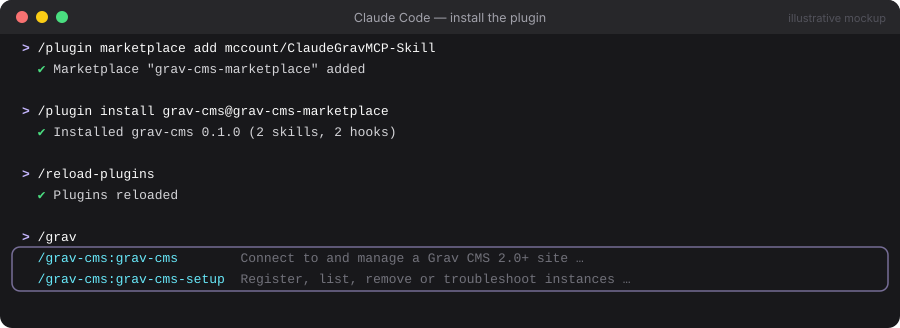
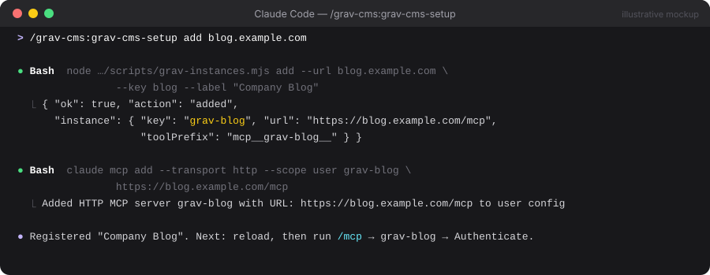
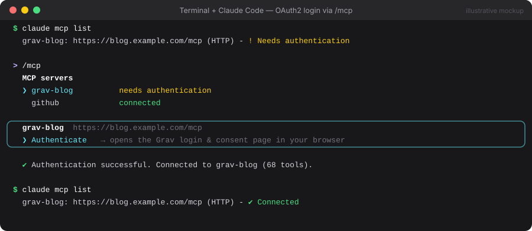
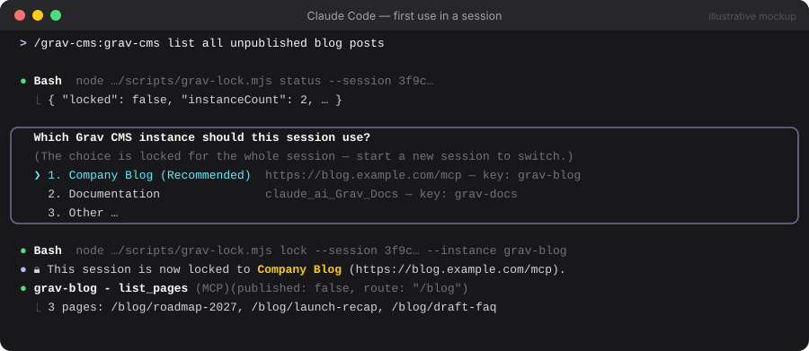
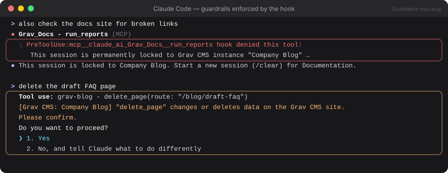

<p align="center"></p>

# Grav CMS for Claude

Manage [Grav CMS 2.0+](https://getgrav.org/blog/grav-2-mcp-server) sites from Claude through their **OAuth2-protected Streamable HTTP MCP endpoint** (`https://<hostname.tld>/mcp`). There are no static API keys: you log in to your Grav site in the browser.

This repository ships two flavours:

| Flavour | For | Instance lock |
|---|---|---|
| **Claude Code plugin** ([`plugins/grav-cms`](plugins/grav-cms)) | Claude Code (terminal, VS Code / JetBrains extension, desktop) | **Technically enforced** by a `PreToolUse` hook |
| **Standalone skill** ([`claude-ai/grav-cms`](claude-ai/grav-cms)) | claude.ai / Claude Desktop with a custom connector | Instruction-based |

> The screenshots in this README are **illustrative mockups** with fictitious sites (`blog.example.com`). Your output will look slightly different.

## Contents

- [Features](#features)
- [Requirements](#requirements)
- [Quick start](#quick-start)
- [Step-by-step setup (Claude Code)](#step-by-step-setup-claude-code)
- [Using it](#using-it)
- [When do I need to reload?](#when-do-i-need-to-reload)
- [Existing claude.ai connectors](#existing-claudeai-connectors)
- [Troubleshooting](#troubleshooting)
- [Standalone skill for claude.ai / Claude Desktop](#standalone-skill-for-claudeai--claude-desktop)
- [Development](#development)

## Features

- **OAuth2 MCP, no tokens in config.** Claude Code (`/mcp`) or the claude.ai connector handles authentication.
- **Multiple instances.** Register as many Grav sites as you like: self-hosted MCP servers or existing claude.ai connectors.
- **Mandatory, immutable per-session instance lock.** The first `/grav-cms:grav-cms` in a session asks which site to use and locks the session to it. The hook then:
  - denies every Grav MCP call until a site is selected,
  - denies calls to any other Grav site in the same session,
  - blocks attempts to edit, delete or prune lock files.
- **Confirmation for destructive actions.** Deleting pages or media, GPM install/update/remove, config changes, cache clears and similar calls trigger a Claude Code permission prompt. You can turn this off.
- **Non-Grav tools are never touched.** When a Grav call is allowed, the hook stays silent, so your normal permission rules still apply.

## Requirements

- A **Grav CMS 2.0+** site with the MCP/API plugin enabled, reachable at `https://<host>/mcp`
- A **Grav user account** with the permissions you want Claude to have. Grav enforces its own ACL and OAuth scopes.
- **Claude Code**, including the `claude` command on your `PATH` (see [step 0](#0-make-sure-the-claude-cli-is-on-your-path))
- **Node.js ≥ 18** on your `PATH`. The plugin's hook and helper scripts are plain Node.js with no dependencies.

## Quick start

For readers who already know Claude Code. Every step is explained below.

```text
# 1. In Claude Code: install the plugin, then reload
/plugin marketplace add mccount/ClaudeGravMCP-Skill
/plugin install grav-cms@grav-cms-marketplace
/reload-plugins

# 2. Register your site (Claude runs the commands and asks before changing your config)
/grav-cms:grav-cms-setup add blog.example.com

# 3. Reload the window / restart Claude Code, then log in
/mcp   →  grav-blog  →  Authenticate

# 4. Work
/grav-cms:grav-cms list all unpublished blog posts
```

## Step-by-step setup (Claude Code)

### 0. Make sure the `claude` CLI is on your PATH

The plugin itself runs inside Claude Code. To register MCP servers you also need the `claude` command in a terminal. The VS Code extension ships its own binary but does **not** put it on your `PATH`. If you get *"claude: command not found"* (on Windows: *"The term 'claude' is not recognized…"*), install the CLI:

| OS | Command |
|---|---|
| Windows (winget) | `winget install Anthropic.ClaudeCode` |
| Windows (PowerShell installer) | `irm https://claude.ai/install.ps1 \| iex` |
| macOS / Linux | `curl -fsSL https://claude.ai/install.sh \| bash` |

Then **open a new terminal** so the updated `PATH` is picked up. In VS Code, also **reload the window** (see [reloading](#when-do-i-need-to-reload)). Check the installation:

```bash
claude --version
node --version
```

### 1. Install the plugin

**Option A: from inside Claude Code (recommended)**

```text
/plugin marketplace add mccount/ClaudeGravMCP-Skill
/plugin install grav-cms@grav-cms-marketplace
/reload-plugins
```

<p align="center"></p>

**Option B: from a terminal**

```bash
claude plugin marketplace add mccount/ClaudeGravMCP-Skill
claude plugin install grav-cms@grav-cms-marketplace
```

**Option C: per project, via `.claude/settings.json`**

Use this to share the plugin with everyone who works on a repository. Claude Code offers to install it when the project is opened (after you trust the marketplace).

```json
{
  "extraKnownMarketplaces": {
    "grav-cms-marketplace": {
      "source": { "source": "github", "repo": "mccount/ClaudeGravMCP-Skill" }
    }
  },
  "enabledPlugins": {
    "grav-cms@grav-cms-marketplace": true
  }
}
```

**🔄 Reload afterwards.** Run `/reload-plugins` in the session, or start a new session, or reload the VS Code window. When you type `/grav`, the two commands `/grav-cms:grav-cms` and `/grav-cms:grav-cms-setup` must show up.

### 2. (Optional) Check that the MCP endpoint exists

```bash
curl -s -o /dev/null -w "%{http_code}\n" https://blog.example.com/mcp
```

On Windows PowerShell, type `curl.exe` instead of `curl`. `401`, `405` or `406` are **good** answers. The endpoint exists; it just rejects a plain browser-style request without an MCP client or OAuth. A `404` means the Grav MCP/API plugin is not installed or enabled, or the path is wrong.

### 3. Register your Grav site

Easiest: let the setup skill do it.

```text
/grav-cms:grav-cms-setup add blog.example.com
```

Claude asks for a label and a short key, then does two things:

1. It adds the site to the plugin's local registry (`~/.claude/grav-cms/instances.json`).
2. It registers the MCP server with Claude Code under the same name (`grav-blog`), but only after you confirm.

<p align="center"></p>

<details>
<summary>Doing it by hand instead</summary>

```bash
# a) Make the MCP server known to Claude Code. OAuth2: no header and no token needed.
claude mcp add --transport http --scope user grav-blog https://blog.example.com/mcp

# b) Register it with the plugin (stores key, label, URL and server name; nothing secret).
#    The plugin lives in the Claude Code plugin cache:
#      ~/.claude/plugins/cache/grav-cms-marketplace/grav-cms/<version>/scripts/
node ~/.claude/plugins/cache/grav-cms-marketplace/grav-cms/0.1.0/scripts/grav-instances.mjs \
  add --url blog.example.com --key blog --label "Company Blog"
```

The MCP server name (`grav-blog`) and the registry's `serverName` must match. The plugin uses it to recognise the site's tools (`mcp__grav-blog__…`).
</details>

**🔄 Reload afterwards.** A running Claude Code session does not pick up servers added with `claude mcp add`. Reload the VS Code window or restart `claude`.

### 4. Log in (OAuth2)

```bash
claude mcp list
#  grav-blog: https://blog.example.com/mcp (HTTP) - ! Needs authentication
```

In Claude Code, run `/mcp`, select **grav-blog**, choose **Authenticate**, then log in and grant access on your Grav site in the browser. In a terminal, `claude mcp login grav-blog` does the same.

<p align="center"></p>

Afterwards `claude mcp list` shows `✔ Connected`. If the tools still don't appear in the session, **🔄 reload** once more.

### 5. Select the site and start working

```text
/grav-cms:grav-cms list all unpublished blog posts
```

On the first use in a session, Claude shows all registered sites and asks you to pick one. This happens even if only one site is registered, so you always confirm explicitly. The session is then **locked** to that site.

<p align="center"></p>

## Using it

Ask in plain language, either after `/grav-cms:grav-cms …` or, once the session is locked, in normal follow-up messages:

```text
/grav-cms:grav-cms show the frontmatter of /blog/launch-recap
fix the typos in the German translation of /about
create a draft blog post "Roadmap 2027" with the tags product and planning
which plugins have updates available?
show me the errors from the last 24 hours in the log
```

**Guardrails you will see:**

- Calls to another Grav site in the same session are **denied**. Start a new session (`/clear` or a new chat) to switch sites.
- Destructive or high-impact actions (`delete_*`, `clear_cache`, `update_config`, GPM installs/updates, …) open a **permission prompt**.

<p align="center"></p>

To switch the confirmation prompts off, set `confirmDestructive` to `false` in `~/.claude/grav-cms/instances.json`:

```json
{ "settings": { "confirmDestructive": false }, "instances": { "…": "…" } }
```

### Managing sites

```text
/grav-cms:grav-cms-setup list
/grav-cms:grav-cms-setup add docs.example.org
/grav-cms:grav-cms-setup remove grav-docs
/grav-cms:grav-cms-setup troubleshoot
```

### Where your data lives

| What | Where |
|---|---|
| Instance registry | `~/.claude/grav-cms/instances.json` (see [`examples/instances.example.json`](examples/instances.example.json)) |
| Session locks | `~/.claude/grav-cms/locks/<session-id>.json` |
| MCP server entries | `~/.claude.json` (written by `claude mcp add --scope user`) |
| OAuth tokens | Managed by Claude Code / claude.ai, **never** by this plugin |

Set `GRAV_CMS_DATA_DIR` to move the registry and locks somewhere else. To clean up old locks, run this in **your own** terminal (Claude is not allowed to):

```bash
node ~/.claude/plugins/cache/grav-cms-marketplace/grav-cms/<version>/scripts/grav-lock.mjs prune --older-than-days 30
```

## When do I need to reload?

| After you… | Do this |
|---|---|
| installed the `claude` CLI | open a new terminal; reload the VS Code window |
| installed / updated / enabled the plugin | `/reload-plugins` (or new session / reload window) |
| added the plugin via `.claude/settings.json` | reload the VS Code window (or restart `claude`), then accept the install prompt |
| ran `claude mcp add …` | reload the VS Code window, or restart `claude` |
| authenticated via `/mcp` and tools are still missing | reload once more |
| want to use a different Grav site | start a new session (`/clear` or new chat) |

**Reload the VS Code window:** <kbd>Ctrl</kbd>+<kbd>Shift</kbd>+<kbd>P</kbd> (macOS: <kbd>Cmd</kbd>+<kbd>Shift</kbd>+<kbd>P</kbd>), then **Developer: Reload Window**.
**Terminal:** exit `claude` and start it again (`claude --continue` resumes the last conversation).

## Existing claude.ai connectors

If you already connected a Grav site as a **claude.ai connector** (Settings → Connectors), Claude Code shows its tools as `mcp__claude_ai_<Connector_Name>__…`.

> **Important:** the plugin treats every MCP server whose name contains `grav` as a Grav site. An unregistered Grav connector is therefore **blocked** until you register it and select it for the session.

Register it with the connector's server name (the part between `mcp__` and the second `__`):

```text
/grav-cms:grav-cms-setup register my claude.ai connector "My Grav Site"
```

or by hand:

```bash
node …/scripts/grav-instances.mjs add --server-name "claude_ai_My_Grav_Site" --key mysite --label "My Grav Site"
```

## Troubleshooting

| Symptom | Cause / fix |
|---|---|
| `claude: command not found` / *not recognized* | Install the CLI ([step 0](#0-make-sure-the-claude-cli-is-on-your-path)), open a new terminal, reload VS Code. |
| `/grav-cms:…` commands don't show up | Plugin not loaded yet: `/reload-plugins`, or check `/plugin` → *Installed*. |
| `claude mcp list` → `! Needs authentication` | Run `/mcp` → server → *Authenticate*, or `claude mcp login <server>`. |
| Tools of the new server are missing | Reload the window / restart `claude` after `claude mcp add` and after logging in. |
| *"No Grav CMS instance has been selected for this session yet"* | Expected. Run `/grav-cms:grav-cms` and pick a site. |
| *"…permanently locked to …"* | Expected. Start a new session to work on another site. |
| *"…looks like a Grav CMS server but is not registered"* | Register that server (see [connectors](#existing-claudeai-connectors)), or fix a `serverName` mismatch: `grav-instances.mjs add --key <key> --server-name <actual name> --update`. |
| `404` on `https://<host>/mcp` | The Grav MCP/API plugin is not installed or enabled, or the URL is wrong. |
| `403` or missing tools after login | The Grav user lacks permissions or OAuth scopes. Ask Claude to run `whoami`, then adjust in the Grav admin. |
| Hook errors mentioning `node` | Node.js ≥ 18 must be on the `PATH` that Claude Code sees. Reload after installing Node. |

## Standalone skill for claude.ai / Claude Desktop

1. Add your Grav site as a custom connector: **Settings → Connectors → Add custom connector** → `https://<host>/mcp`, then authorize it.
2. Build the skill package (or download it from a release):
   ```bash
   npm run build:skill   # → dist/grav-cms-skill.zip
   ```
3. Upload it under **Settings → Capabilities → Skills → Upload skill**.

There are no hooks on claude.ai, so the skill's instructions alone enforce the instance lock.

## Repository layout

```text
.claude-plugin/marketplace.json     marketplace manifest (this repo = one-plugin marketplace)
plugins/grav-cms/
  .claude-plugin/plugin.json        plugin manifest
  skills/grav-cms/                  main skill (+ references/operations.md)
  skills/grav-cms-setup/            register / remove / troubleshoot instances
  hooks/hooks.json                  PreToolUse hook wiring
  scripts/                          zero-dependency Node.js helpers + hook
claude-ai/grav-cms/                 hook-free skill for claude.ai / Claude Desktop
docs/images/                        README mockups (generated)
examples/                           example registry (fake hosts only)
tests/                              node:test suite
tools/                              build, validate and screenshot scripts
```

## Development

```bash
npm test             # unit + hook behaviour tests, secret scan
npm run validate     # claude plugin validate (uses claude from PATH or the VS Code extension binary)
npm run sync         # copy the shared operations reference into the claude.ai skill
npm run build:skill  # build dist/grav-cms-skill.zip
npm run screenshots  # re-render docs/images/*.svg
```

To test local changes without installing the plugin, run `claude --plugin-dir ./plugins/grav-cms`.

## Security notes

- Never commit `instances.json`, `mcp_config.json` or `.mcp.json` files that contain real hosts. They are git-ignored, and the test suite fails if one shows up.
- The plugin never asks for or stores passwords, API keys or OAuth tokens.
- The instance lock protects against *accidental* cross-site changes by the model. It is not a security boundary against a user who has shell access to their own machine.

## Origin

This is a port of a Grav CMS plugin originally built for Google Antigravity, adapted to Claude Code's plugin, skill and hook model.

## License

[MIT](LICENSE)
